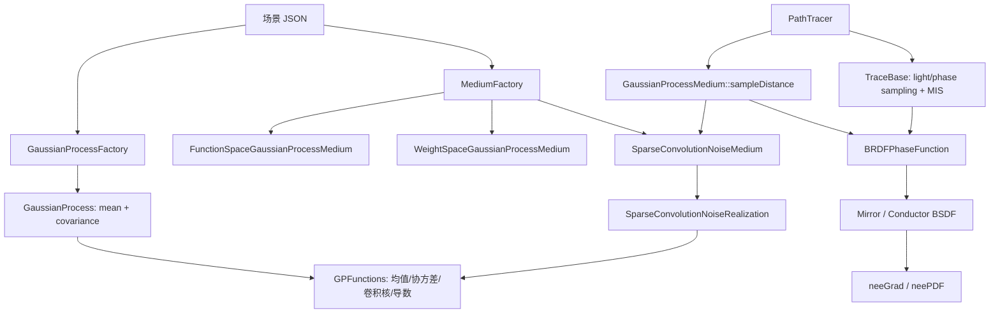

# 《Practical Gaussian Process Implicit Surfaces with Sparse Convolution》论文与代码深度导读

> 论文：Kehan Xu、Benedikt Bitterli、Eugene d'Eon、Wojciech Jarosz，SIGGRAPH Asia 2025 / ACM TOG 44(6)，Article 188。  
> 本文档以仓库内的 18 页作者版 PDF 与当前工作区源码为准。公式编号、算法编号和章节号沿用论文。  
> 项目主页：<https://cs.dartmouth.edu/~wjarosz/publications/xu25practical.html>

## 1. 先用一句话理解整篇论文

论文把一个随机隐式函数

$$
f(\mathbf p)=\mu(\mathbf p)+\psi(\mathbf p)
$$

的零水平集 $f(\mathbf p)=0$ 当成表面，其中 $\mu$ 决定宏观形状，随机场 $\psi$ 决定微观起伏、孔洞和颗粒；再用“有限支撑核在随机脉冲上的局部叠加”近似 $\psi$，从而把原来需要反复分解大协方差矩阵的 GPIS，变成每次只查询固定数量邻格的程序噪声。

论文真正解决了四个相互关联的问题：

1. **怎样廉价地产生 GPIS realization**：用 sparse convolution noise（稀疏卷积噪声）近似高斯过程。
2. **怎样保持光路前后几段看到的是相容几何**：用 pathwise update 实现值和梯度条件化。
3. **怎样只生成光线真正需要的随机量**：集合平均时把 3D 噪声降成沿光线的 1D 噪声。
4. **镜面 GPIS 怎样做直接光照采样**：推导交点处剩余两个横向梯度分量的解析高斯分布，把光源采样、GP 梯度采样用 MIS 合并。

这里的 “sparse convolution” **不是神经网络里的 sparse convolution layer**。它指 Lewis/Lagae 一系程序噪声方法：在空间中随机放置带权核函数（kernel splats），查询点只累加附近有限个核。

## 2. 最重要的心智模型

### 2.1 一个 GPIS realization 是什么

高斯过程 $f\sim\operatorname{GP}(\mu,\kappa)$ 是“函数的概率分布”。从中抽一次样得到一个确定函数 $f$，它的零水平集就是一次确定的几何 realization：

$$
\mathcal S_f=\{\mathbf p\in\mathbb R^3\mid f(\mathbf p)=0\}.
$$

若 $f$ 可微，表面法线为

$$
\mathbf n_f(\mathbf p)=\frac{\nabla f(\mathbf p)}{\lVert\nabla f(\mathbf p)\rVert}.
$$

代码中的直接对应是：

- `GaussianProcess` 保存均值函数 `_mean` 和协方差函数 `_cov`，见 [`GaussianProcess.hpp`](src/core/math/GaussianProcess.hpp) 与 [`GaussianProcess.cpp`](src/core/math/GaussianProcess.cpp) L172–L190。
- `SparseConvolutionNoiseRealization::evaluateValue()` 计算 $f=\mu+\psi$，见 [`SparseConvolutionNoise.cpp`](src/core/math/SparseConvolutionNoise.cpp) L73–L89。
- `evaluateGradient()` 计算 $\nabla f=\nabla\mu+\nabla\psi$，见同文件 L92–L99。
- `SparseConvolutionNoiseMedium::intersectGP()` 沿光线找 $f$ 的第一次符号变化，即零交叉，见 [`SparseConvolutionNoiseMedium.cpp`](src/core/media/SparseConvolutionNoiseMedium.cpp) L102–L182。

### 2.2 为什么同一个模型既像表面又像体积

$\mu$ 决定平均边界，$\psi$ 的振幅和相关长度决定边界附近随机结构的形态：

- 随机振幅较小、相关长度适中：零水平集紧贴 $\mu=0$，宏观上像粗糙表面。
- 随机振幅较大或均值在宽区域接近零：出现许多断裂零水平集，宏观上像颗粒/烟雾体积。
- 相关长度小于像素足迹：单个像素内平均许多微结构，空间平均接近 realization 集合平均。

Coffee Mug 场景把这三件事做得最直观：VDB 的 `mean` 网格给宏观杯子/烟雾形状，`variance` 网格区分 surface/volume 区域，再用不同振幅和 length scale 生成表面凸起或体积颗粒，见 [`coffee-mug-ensemble-average.json`](gpis-scenes/coffee-mug/coffee-mug-ensemble-average.json) L51–L105。

### 2.3 论文中的两种“平均”不要混淆

- **单 realization / 空间平均**：整张图、所有光路都查询同一个固定随机场；微结构真实存在，放大后可见。
- **集合平均（ensemble average）**：Monte Carlo 的不同像素样本抽不同随机场，最终像素对所有可能微几何求期望。

论文式 (2) 写的是

$$
\langle L^f\rangle_\zeta=\int_{\mathrm{GP}}L^f\,\mathrm d\gamma(f\mid\zeta).
$$

代码通过 seed 策略实现二者。`computeSeed()` 在 `single_realization=true` 时只返回全局 seed；否则把 pixel、sample、path segment 与 scene seed 做哈希，见 [`SparseConvolutionNoise.cpp`](src/core/math/SparseConvolutionNoise.cpp) L40–L49。

## 3. 仓库架构：论文概念落在哪里



| 作用 | 关键文件 | 论文对应 |
| --- | --- | --- |
| JSON 类型注册 | [`MediumFactory.cpp`](src/core/media/MediumFactory.cpp) L13–L22 | 三种 GP 表示的入口 |
| GP、均值、协方差对象注册 | [`GaussianProcessFactory.cpp`](src/core/math/GaussianProcessFactory.cpp) | 附录 A、表 1、非平稳参数场 |
| GP 数学与通用条件分布 | [`GaussianProcess.cpp`](src/core/math/GaussianProcess.cpp) | 式 (27)–(32)，旧 function-space 路径 |
| 函数空间基线 | [`FunctionSpaceGaussianProcessMedium.cpp`](src/core/media/FunctionSpaceGaussianProcessMedium.cpp) | Seyb et al. 方法、论文对比基线 |
| RFF 权重空间基线 | [`WeightSpaceGaussianProcess.cpp`](src/core/math/WeightSpaceGaussianProcess.cpp)、[`WeightSpaceGaussianProcessMedium.cpp`](src/core/media/WeightSpaceGaussianProcessMedium.cpp) | 式 (30)、图 4/7 的 RFF |
| 本文 sparse convolution 数学核心 | [`SparseConvolutionNoise.cpp`](src/core/math/SparseConvolutionNoise.cpp) | 式 (8)–(18)、(24)–(26)，算法 1/3/4 |
| 核、协方差、非平稳变换 | [`GPFunctions.hpp`](src/core/math/GPFunctions.hpp)、[`GPFunctions.cpp`](src/core/math/GPFunctions.cpp) | 式 (4)–(7)、表 1、多分辨率 |
| 零交叉求交 | [`SparseConvolutionNoiseMedium.cpp`](src/core/media/SparseConvolutionNoiseMedium.cpp) | 算法 2/3 的 ray marching |
| GPIS 作为 Tungsten medium | [`GaussianProcessMedium.cpp`](src/core/media/GaussianProcessMedium.cpp) | 交点、法线、0/1 透射率 |
| 表面材质适配 | [`BRDFPhaseFunction.cpp`](src/core/phasefunctions/BRDFPhaseFunction.cpp) | 在 GPIS 交点计算微表面 BSDF |
| 镜面 NEE 的梯度 PDF | [`MirrorBsdf.cpp`](src/core/bsdfs/MirrorBsdf.cpp)、[`ConductorBsdf.cpp`](src/core/bsdfs/ConductorBsdf.cpp) | 算法 4 |
| UNI/NEE/MIS 调度 | [`TraceBase.cpp`](src/core/integrators/TraceBase.cpp) L346–L419 | 式 (26)、算法 4 |
| 整体路径追踪循环 | [`PathTracer.cpp`](src/core/integrators/path_tracer/PathTracer.cpp) | 式 (1)–(3) 的 MC 实现 |

一个容易误读的设计是：**GPIS 在 Tungsten 里注册为 `Medium`，但其散射事件实际是隐式表面事件**。`sampleDistance()` 找到的是 $f=0$，`BRDFPhaseFunction` 再把梯度归一化为几何法线并调用普通 BSDF。包成 medium 是为了复用距离采样、透射率和路径状态机制，不表示论文把 GPIS 简化成了普通密度场。

## 4. 三种 GP 表示为什么性能不同

### 4.1 Function space：直接采有限点的联合高斯

论文附录式 (29)：对 $n$ 个查询点 $P$，

$$
f(P)=\mu(P)+K(P,P)^{1/2}\boldsymbol\xi,
\qquad \boldsymbol\xi\sim\mathcal N(0,I).
$$

需要构造 $n\times n$ 协方差矩阵并做 Cholesky/特征分解，复杂度通常为 $O(n^3)$。仓库实现按 ray-marching batch 采 `_samplePoints` 个点：

1. `intersectGP()` 生成一批等距光线点，见 [`FunctionSpaceGaussianProcessMedium.cpp`](src/core/media/FunctionSpaceGaussianProcessMedium.cpp) L58–L124。
2. 首段或续段调用 `GaussianProcess::sample()` / `sample_cond()` 构造条件多元高斯并采样，见 L126–L209。
3. 在采样值中找第一次符号变化，线性插值得交点，见 L211–L267。
4. 交点横向梯度再从条件高斯采样，见 L284–L345 及 [`GaussianProcess.cpp`](src/core/math/GaussianProcess.cpp) L89–L132。

场景中的 `"sample_points": 8` 是论文结果采用的 batch size。batch 减小会加快矩阵运算，但只把相关性传播到相邻 batch，是基线方法自己的近似。

### 4.2 Weight space / RFF：全局正弦基展开

论文式 (30)：

$$
f(\mathbf p)=\mu(\mathbf p)+\sum_{i=1}^{b}\phi_i(\mathbf p)w_i.
$$

仓库基线采用 random Fourier features：从协方差谱密度采频率与方向，随机相位为 $[0,2\pi)$，每个 realization 采标准正态权重。对应代码：

- 基函数求值 $\sqrt{2/b}\sum_iw_i\cos(\mathbf d_i^T\mathbf p\,\omega_i+\theta_i)$：[`WeightSpaceGaussianProcess.cpp`](src/core/math/WeightSpaceGaussianProcess.cpp) L120–L127。
- 解析梯度：同文件 L129–L137。
- 频率、方向、相位采样：L160–L215。
- realization 权重采样：L235–L239。

每次查询是 $O(b)$；它适合固定的全局 realization，但普通 RFF 依赖平稳协方差的谱表示，而且低特征数容易产生重复的正弦纹理。`WeightSpaceGaussianProcessMedium` 中的 `basis_functions` 控制 $b$。

### 4.3 Sparse convolution：局部、无限候选基，但每点只看有限邻域

论文把卷积核中心 $\mathbf s_i$ 看成局部基函数：

$$
\phi_i(\mathbf p)=h(\mathbf s_i,\mathbf p),\qquad
\psi_\lambda(\mathbf p)=\sum_iw_i h(\mathbf s_i,\mathbf p).
$$

空间里可以概念上存在无限多基函数，但若 $h$ 有有限支撑，任意查询点只与附近固定数量的基重叠，于是单点查询为 $O(1)$，且允许核参数随位置变化。

| 表示 | 单点成本 | 全局 realization | 非平稳 | 主要误差/成本 |
| --- | ---: | --- | --- | --- |
| Function space | 随条件点数增长，分解约 $O(n^3)$ | 实际上很昂贵 | 支持 | batch 条件近似、大矩阵 |
| RFF weight space | $O(b)$ | 支持 | 本仓库基线不实用 | 有限频率基近似 |
| Sparse convolution | 固定密度下 $O(3^dN)$，即 $O(1)$ | 支持 3D | 支持 | 有限脉冲密度、核截断、多分辨率近似 |

这里 $d$ 是噪声维度，$N$ 是每格脉冲数。3D 查询访问 27 格，1D 查询访问 3 格。

## 5. 从卷积白噪声到代码中的 sparse convolution

### 5.1 论文式 (4)–(7)：为什么卷积会给出合法 GP

从方差为 $\sigma^2$ 的高斯白噪声 $W$ 出发：

$$
\psi_{\text{dense}}(\mathbf p)
=\int h(\mathbf s,\mathbf p)W(\mathbf s)\,\mathrm d\mathbf s.
$$

线性变换保持高斯性，其协方差是卷积核的自相关：

$$
\kappa(\mathbf p,\mathbf p')
=\sigma^2\int h(\mathbf s,\mathbf p)h(\mathbf s,\mathbf p')\,\mathrm d\mathbf s.
$$

对任意向量 $\mathbf q$，

$$
\mathbf q^TK\mathbf q
=\sigma^2\int\left(\sum_iq_i h(\mathbf s,\mathbf p_i)\right)^2\mathrm d\mathbf s\ge 0,
$$

所以只要 $h$ 平方可积，得到的 $\kappa$ 自动半正定。这是“作者只需设计局部核，不必再手工证明复杂协方差有效”的理论基础。

代码把两类函数严格分开：

- `splattingKernel...` 表示卷积核 $h$，用于生成噪声和 pathwise splat。
- `covarianceKernel...` / `cov(...)` 表示协方差 $\kappa$，用于条件化和梯度分布。

不要把 GP 文献也常称为 kernel 的 $\kappa$ 与这里实际被卷积的 $h$ 混为一谈。

### 5.2 平方指数核在代码里的参数换算

所有论文结果都使用 squared exponential convolution kernel。场景 JSON 写的是目标协方差 length scale `lengthScale = l`：

$$
\kappa(r)=\sigma^2\exp\left(-\frac{r^2}{2l^2}\right).
$$

两个高斯函数卷积后方差相加，因此生成该协方差所需的卷积核尺度是 $l/\sqrt2$。代码在解析 JSON 时设置

```cpp
_l_conv = _l * sqrt(2.f) / 2;
```

见 [`GPFunctions.cpp`](src/core/math/GPFunctions.cpp) L654–L679。核值、一次导数、二次导数的手写实现位于 L774–L864；通用自动微分版本虽然保留着，但注释明确说明 sparse convolution 路径为性能使用手写导数。

默认 `localScale = 3`，见 [`GPFunctions.hpp`](src/core/math/GPFunctions.hpp) L1486–L1497、L1735–L1738。于是实际有限支撑半径约为 $3l/\sqrt2$（再乘各向异性和非平稳尺度），代码在半径之外直接不累加核。这是“无限支撑高斯”的截断近似。

### 5.3 论文式 (8)–(11)：用稀疏脉冲近似白噪声

论文先写随机脉冲过程

$$
W_\lambda(\mathbf s)=\sum_iw_i\delta(\mathbf s-\mathbf s_i),
$$

再代入卷积得到

$$
\psi_\lambda(\mathbf p)=\sum_iw_i h(\mathbf s_i,\mathbf p).
$$

理论版本中 $\mathbf s_i$ 来自密度 $\lambda$ 的 Poisson 点过程，$E[w_i]=0$、$E[w_i^2]=\sigma^2/\lambda$。有限 $\lambda$ 时它不是严格 GP，但协方差与 dense 版本相同；$\lambda\to\infty$ 时由随机测度中心极限定理依分布收敛到 GP。

### 5.4 算法 1 与 `noise3D()` 的逐步对应

以下是一次 3D 查询的真实执行步骤：

1. `evaluateValue()` 根据渲染模式计算 realization seed，并查询局部振幅，L73–L76。
2. `evaluateNoise3D()` 决定在 world space、isotropic space 还是 isotropic-ray space 求值，并判断是否使用多分辨率，L101–L124。
3. `noise3D()` 用 `p / kernelRadius` 得到格坐标与整数格索引，L362–L366。
4. 三重循环访问查询格及相邻格，共 $3^3=27$ 格，L368–L371。
5. `cell3D()` 对 `(cell z,y,x,seed)` 做 `xxhash32`，把无状态格索引变成可重复 RNG 状态，L375–L376。
6. 每格生成固定数量的随机核中心 `p_i`，生成 $w_i\in\{-1,+1\}$，L378–L387。
7. 只在归一化距离小于 1 时计算核值和梯度，L389–L391。
8. 27 格结果累加后，除以理论方差平方根做单位方差归一化，L251–L255。
9. 若当前是次级光线且 memory model 需要条件化，再加 value/gradient pathwise splat，L256–L258。
10. 最终乘空间振幅并加均值，得到 $f(\mathbf p)$，L75–L88。

1D 版本完全同构：`noise1D()` 只访问当前格与左右邻格，`cell1D()` 生成一维核中心并同时返回值和沿光线导数，见 L397–L427。

### 5.5 发布代码与论文算法 1 的两个有意差异

论文伪代码使用“每格 Poisson 数量 + 高斯权重”；发布实现按 Sec. 7.1 的说明采用 Tavernier et al. 的更快变体：

- `uint number_of_impulses = uint(impulseDensity)`：每格固定 $N$ 个脉冲，Poisson 行被注释掉。
- 权重是等概率 Bernoulli `-1/+1`，高斯/均匀替代也仅保留为注释。

只要权重零均值且按其方差重新归一化，二阶统计仍可匹配；但低密度时高阶分布与真正 GP 有偏，这正是图 3、图 18 与 Sec. 8 讨论的误差来源。另一个实用细节是 `impulse_density` 最后被强转为无符号整数，**不要设置成小于 1 的正小数**，否则每格脉冲数会变成 0。

3D 理论方差归一化在 [`GPFunctions.cpp`](src/core/math/GPFunctions.cpp) L741–L759：代码先把“每格数量”换成单位体积/长度密度，再乘 $\int h^2$。这对应论文式 (10) 的 $\lambda E[W_\lambda^2]$ 缩放。

## 6. Seed、global realization 与 ensemble average

`RayInfo.pixelSampleSegment = (pixel.x, pixel.y, spp, bounce)`，在 [`PathTracer.cpp`](src/core/integrators/path_tracer/PathTracer.cpp) L45–L49 初始化，并在每次 bounce 更新 `.w()`，L62–L65。

`SparseConvolutionNoiseRealization::computeSeed()` 的行为可以概括为：

| 设置 | seed 行为 | 几何含义 |
| --- | --- | --- |
| `single_realization=true` | 恒为 medium 的 `_globalSeed` | 所有像素、SPP、bounce 查询同一随机场 |
| `single_realization=false`, `global` | 哈希 pixel/sample，但把 bounce 清零 | 一条完整 path 内一致；不同 MC sample 是不同 realization |
| `single_realization=false`, `renewal/renewal+` | 哈希 pixel/sample/bounce | 每个 path segment 重采 prior，再在起点条件化 |
| `none` | 每段重采且不继承条件 | 最弱相关的近似 |

这里的 `global` 是 **memory model**，意思是一条光路保留全局 realization；`single_realization` 是 **图像级采样模式**，意思是不同像素样本是否也共享 realization。二者不是同一开关。

还有一个限制：代码注释指出 global model 目前只能可靠地走 world-space 3D 评价；isotropic-ray space 随每条 ray 旋转，无法天然定义同一个全局三维场，见 [`SparseConvolutionNoise.cpp`](src/core/math/SparseConvolutionNoise.cpp) L291–L303。因此固定 realization 场景均使用 3D world-space 路径。

## 7. 非平稳、各向异性与多分辨率

### 7.1 三个坐标空间

代码明确区分：

1. **World space**：场景/VDB 所在空间。
2. **Isotropic space**：用 length scale/anisotropy 矩阵缩放后，核变成单位各向同性。
3. **Isotropic ray space**：在 isotropic space 上再旋转，使光线方向成为局部 $z$ 轴。

位置/方向用 $M$ 变换，梯度按逆转置变换。`StationaryCovariance::transformPosDir...` 与 `transformGrad...` 位于 [`GPFunctions.cpp`](src/core/math/GPFunctions.cpp) L631–L649；3D 评价的变换及回变换位于 [`SparseConvolutionNoise.cpp`](src/core/math/SparseConvolutionNoise.cpp) L269–L319。

### 7.2 非平稳字段怎样进入核

`NonstationaryCovariance` 包一层 stationary covariance，并让振幅、尺度、各向异性随位置变化：

- `sparseConvNoiseAmplitude(p)`：局部 variance field 乘底层核的 `sigma`，见 [`GPFunctions.cpp`](src/core/math/GPFunctions.cpp) L1235–L1237。
- `sparseConvNoiseLateralScale(p)`：读取局部 length-scale field，L1219–L1221。
- `ProceduralNonstationaryCovariance` 从 `var`、`ls`、`aniso` 三个程序字段取参数，L1590–L1604、L1638–L1746。
- `GridNonstationaryCovariance` 从 VDB 读取振幅，并可针对 surface/volume 使用两组幅度和尺度，L1338–L1427。

一般非平稳协方差不是简单地只把 $l$ 换成 $l(\mathbf p)$。函数空间路径使用 Paciorek–Schervish 型的两点尺度/各向异性组合；sparse-convolution 路径则直接让每个 splat 的局部形状随位置变化，因此协方差由核自相关自动保持合法。

### 7.3 多分辨率 sparse convolution

若尺度变化范围很大，用全局最大支撑半径建格会在小尺度区域极度浪费。代码的多分辨率策略：

1. 以经验底数 `base = 2.5`，把局部尺度夹在相邻两层 $l_\text{low}$、$l_\text{high}$ 之间。
2. 分别生成两套独立噪声 realization。
3. 用经过方差归一化的权重混合：

$$
r_l=\frac{1-t}{\sqrt{(1-t)^2+t^2}},\qquad
r_h=\frac{t}{\sqrt{(1-t)^2+t^2}}.
$$

4. 于是 $r_l^2+r_h^2=1$，两层独立且单位方差时，混合后仍保持单位方差。

层级与权重在 [`SparseConvolutionNoise.cpp`](src/core/math/SparseConvolutionNoise.cpp) L60–L70 计算；两层值/梯度的合成在 L107–L121、L126–L134、L188–L237。不同层还向 seed 加上层号，避免误用同一随机场。

它准确处理“尺度变化而各向异性不剧烈变化”的常见情况。快速变化的方向性非平稳仍要提高全局脉冲密度，论文 Sec. 8 和图 18 将其列为限制。

## 8. Pathwise conditioning 与 memory model

### 8.1 通用值条件化：论文式 (12)–(13)

先采 prior $\psi$，再叠加以条件点为中心的协方差函数：

$$
\psi\mid_C(\mathbf p)=\psi(\mathbf p)+\kappa(\mathbf p,C)\mathbf u,
$$

其中

$$
K(C,C)\mathbf u=\mathbf v-\psi(C).
$$

直观上：prior 不必重采；只要加一组 RBF 式“修正隆起”，就能让新 realization 精确穿过观测值。

### 8.2 梯度与联合条件化：论文式 (14)–(18)

条件化梯度时 splat 的不是 $\kappa$ 本身，而是对第二参数的导数：

$$
\psi\mid_{C'}(\mathbf p)
=\psi(\mathbf p)+\sum_i\nabla_2^T\kappa(\mathbf p,\mathbf c'_i)\mathbf u'_i.
$$

值与梯度联合后，需要解论文式 (18) 的块系统：

$$
\begin{bmatrix}
K(C,C) & \nabla_2^T K(C,C')\\
\nabla_1K(C',C) & \nabla_1\nabla_2^TK(C',C')
\end{bmatrix}
\begin{bmatrix}\mathbf u\\\mathbf u'\end{bmatrix}
=
\begin{bmatrix}\mathbf v-\psi(C)\\\mathbf v'-\nabla\psi(C')\end{bmatrix}.
$$

### 8.3 发布代码为什么看不到通用 4×4 求解器

渲染时使用 Renewal/Renewal+，每条次级 ray 只在起点保留一个值与一个 3D 梯度，即 $|C|=|C'|=1$。对代码实际使用的同点、平稳 squared-exponential 核：

- $\kappa(\mathbf p,\mathbf p)=1$（噪声已经归一化）；
- 同点的一阶导为 0，值与梯度块解耦；
- 梯度块由同点二阶导矩阵给出。

因此通用 4×4 系统可以化成一个标量除法和一个 3×3 逆二阶导变换。实现没有每次构造 Eigen 4×4 矩阵，而是直接算闭式系数：

- 3D value 系数：[`SparseConvolutionNoise.cpp`](src/core/math/SparseConvolutionNoise.cpp) L456–L467。
- 3D gradient 系数：L477–L508。
- 1D value/gradient 系数：L534–L579。
- 查询时加回协方差/导数 splat：3D 为 L251–L259，1D 为 L337–L357。

调用发生在每条次级 ray 开始处：`SparseConvolutionNoiseMedium::intersectGP()` 从 `MediumState.lastVal/lastAniso` 取上一个交点的值与梯度，然后 `noise.conditioning(...)`，见 [`SparseConvolutionNoiseMedium.cpp`](src/core/media/SparseConvolutionNoiseMedium.cpp) L117–L123。

### 8.4 四种 memory model 的实际含义

| 模型 | 传到下一段的条件 | 代码开关 | 代价与效果 |
| --- | --- | --- | --- |
| `none` | 无 | `correlation_context: none` | 每段独立，最便宜、相关性最弱 |
| Renewal | 交点值 $f=0$ | `renewal` | 一次 value splat |
| Renewal+ | 交点值与完整梯度 | `renewal+` 且 1D 时 `1D_gradient_correlationXY: true` | 法线连续性更强，但横向分布变窄 |
| Renewal Half+ | 值与沿新 ray 的导数保留；忽略横向梯度跨段相关 | `renewal+` 且 `1D_gradient_correlationXY: false` | 论文结果默认；与 Renewal+ 接近但 NEE 更有效 |
| Global | 整条 path 使用同一 realization | `global` | 不做局部 splat，靠相同 seed 保持全局一致 |

`_activateConditioning` 只在“非单 realization 且 Renewal/Renewal+”时打开，见 [`SparseConvolutionNoise.cpp`](src/core/math/SparseConvolutionNoise.cpp) L21–L30。

需要诚实区分论文能力与当前仓库能力：Sec. 5 还描述了含任意多 value/gradient constraints 的**建模期条件化**。仓库的通用 `GaussianProcess`/function-space 路径有 `conditioning_data` 与矩阵求解设施，但 sparse-convolution 渲染主路径只实现了上述单起点 render-time 条件化；并没有一个完整暴露给场景 JSON 的任意约束 pathwise 编辑器。

## 9. 为什么 1D 噪声可把成本再降一截

求一条 ray 的首次零交叉只需要 $f(\mathbf p(t))$ 和沿 ray 的方向导数 $g_z$。在 Renewal 系列模型中，下一段不会要求当前段之外的完整 3D realization，因此可以直接合成统计等价的一维随机过程：

$$
\psi_{1D}(t)=\sum_iw_i h_{1D}(t-t_i).
$$

查询从 27 格降到 3 格，核评价数理论上减少 9 倍。剩余横向梯度 $(g_x,g_y)$ 不从 3D 噪声求，而是在交点显式采高斯，见 `evaluateGradientNoise1D()`：

1. 从 1D 卷积噪声得到 $g_z$，[`SparseConvolutionNoise.cpp`](src/core/math/SparseConvolutionNoise.cpp) L149–L150。
2. 独立采两个标准正态数，并按 $1/\sqrt2$ 与局部 anisotropy scale 缩放得到 $g_x,g_y$，L151–L166。
3. Renewal+ 若要求横向相关，则用上一顶点横向梯度计算条件均值和方差，L168–L181；关闭该相关就是 Renewal Half+。
4. 从 ray-local 坐标旋回 isotropic space，再按逆转置回 world space，L184–L186。

**1D 方法是集合平均下的统计替代，不是某个固定 3D 随机场沿 ray 的真实切片拼接。** 所以它适合 Renewal/Renewal+/Half+ ensemble transport，不适合展示可从任意视角重复查询的单个微几何 realization。单 realization 场景应使用 3D。

## 10. 从发射相机光线到一次 GPIS bounce：完整调用链

下面按一条像素样本真实执行的顺序串起代码。

### 步骤 1：解析场景并创建 medium

JSON 中 `"type": "sparse_conv_noise"` 经 [`MediumFactory.cpp`](src/core/media/MediumFactory.cpp) L13–L22 创建 `SparseConvolutionNoiseMedium`。随后：

- 基类读取 `sigma_a/sigma_s/density`、memory model、GP 对象，见 [`GaussianProcessMedium.cpp`](src/core/media/GaussianProcessMedium.cpp) L97–L126。
- 子类读取 step、seed、脉冲密度、1D/3D 与采样策略，见 [`SparseConvolutionNoiseMedium.cpp`](src/core/media/SparseConvolutionNoiseMedium.cpp) L57–L73。
- `GaussianProcess::fromJson()` 创建 mean/covariance，见 [`GaussianProcess.cpp`](src/core/math/GaussianProcess.cpp) L172–L190。

### 步骤 2：用一个普通 primitive 限定 GPIS 计算域

场景通常放一个 `bsdf: forward` 的 cube，并设置 `int_medium: gp`。光线先由 Embree 与这个便宜的边界盒求交，进入后才运行昂贵的 GPIS ray marching。Dragon 对应 [`dragon-sparse-conv-ensemble.json`](gpis-scenes/dragon/dragon-sparse-conv-ensemble.json) L147–L168。

### 步骤 3：初始化光路级随机标识与状态

`PathTracer::traceSample()` 设置 `(pixel, spp, bounce)` 和 scene seed，重置 `MediumState`，见 [`PathTracer.cpp`](src/core/integrators/path_tracer/PathTracer.cpp) L31–L52。

### 步骤 4：请求介质距离样本

主循环调用 `medium->sampleDistance()`，见 [`PathTracer.cpp`](src/core/integrators/path_tracer/PathTracer.cpp) L62–L81。`GaussianProcessMedium::sampleDistance()` 又调用虚函数 `intersectGP()`，见 [`GaussianProcessMedium.cpp`](src/core/media/GaussianProcessMedium.cpp) L260–L301。

### 步骤 5：构造本段 realization，并在次级 ray 起点条件化

`SparseConvolutionNoiseMedium::intersectGP()` 创建轻量的 `SparseConvolutionNoiseRealization`。若不是首个散射段，就用上一交点的 `lastVal`、`lastAniso` 添加 pathwise update，见 [`SparseConvolutionNoiseMedium.cpp`](src/core/media/SparseConvolutionNoiseMedium.cpp) L102–L123。

### 步骤 6：确定 ray-marching 步长

$$
\Delta t=\min\left(\texttt{step\_size},\frac{t_{far}-t_{near}}{\texttt{min\_step}}\right).
$$

见同文件 L106–L109。`min_step` 保证很短的边界段仍至少被粗分若干次；每段起始位置再加 $U[0,1)\Delta t$ 的随机 jitter，L125–L130，以减弱固定步长的结构性 aliasing。

### 步骤 7：逐点计算 $f=\mu+\psi$ 并找首次符号翻转

循环位于 L131–L174。每个点的噪声由格哈希即时重建，不储存体素随机场。若相邻样本符号不同，就认为跨过 $f=0$。

### 步骤 8：细化零交叉

先用割线式线性插值比例

$$
\alpha=\frac{f_{prev}}{f_{prev}-f_{curr}}
$$

估计交点，再在仍落到错误一侧时把 $\alpha$ 乘 0.9 回退，见 L142–L162。这不是通用高精度 root solver，而是为稳定获得“外到内”的第一次交点设计的保守细化。

### 步骤 9：保存 realization 上下文并采梯度

命中后保存 GP id、UNI/NEE/MIS 策略和包含当前 noise 系数/seed 规则的 `GPContextSparseConvNoise`，L163–L169。随后 `sampleDistance()` 调 `sampleGradient()` 得到交点梯度，写入 `state.lastAniso`，见 [`GaussianProcessMedium.cpp`](src/core/media/GaussianProcessMedium.cpp) L275–L296。

代码还要求 `gradient · rayDir <= 0`，即接受从 $f>0$ 外部进入 $f<0$ 内部的定向零交叉；反向梯度或退化梯度会拒绝该样本，L303–L314。

### 步骤 10：把 GPIS 事件包装成表面 BSDF 事件

`sample.phase` 取对应 `BRDFPhaseFunction`，L333–L339。[`BRDFPhaseFunction.cpp`](src/core/phasefunctions/BRDFPhaseFunction.cpp) L27–L43 把归一化梯度设为 `Ng/Ns`，建立 tangent frame，再调用 mirror/conductor 等普通 BSDF。

因此 `sigma_s=1`、`pdf=1` 在这里主要是复用 Tungsten medium 接口的 bookkeeping，并不是指数自由程的体散射模型。

### 步骤 11：直接光照、相函数采样和递归

`PathTracer` 对 GPIS 命中走 `handleVolume()`，见 [`PathTracer.cpp`](src/core/integrators/path_tracer/PathTracer.cpp) L129–L141。后者：

- 若启用直接光照，调用 `volumeEstimateDirect()` 采光源。
- 总是再从 phase/BSDF 采续接方向。
- 把 throughput 乘 BSDF sample weight，生成下一条 ray。

对应 [`TraceBase.cpp`](src/core/integrators/TraceBase.cpp) L511–L563。

### 步骤 12：阴影光线的可见性仍由随机 GPIS 判断

`GaussianProcessMedium::transmittance()` 对阴影 ray 再做同样的 GPIS 求交：有零交叉返回 0，无交点返回 1，见 [`GaussianProcessMedium.cpp`](src/core/media/GaussianProcessMedium.cpp) L343–L393。它不是 Beer–Lambert 的连续衰减，而是一个 realization 内的二值遮挡；对 realization 求平均后才产生宏观透射行为。

## 11. 法线分布、NEE 与 MIS

### 11.1 为什么固定 realization 上的镜面不能普通 NEE

对固定 realization，交点法线已经确定；若 micro-BSDF 是 mirror/conductor，出射方向也唯一。普通“先采光源方向、再评价 delta BSDF”几乎必为零。

集合平均却还有自由度：沿入射 ray 的观测只锁定随机几何的一维切片。存在无穷多相容的 3D realizations，它们共享交点和沿 ray 的值，却可有不同横向梯度，因此可以选择一个会把 mirror 方向反射向光源的相容法线。

### 11.2 论文式 (20)–(24)：从法线改看梯度

法线是梯度方向。法线密度是梯度密度沿长度 $t$ 的边缘化：

$$
p_n(\mathbf n\mid\zeta)=\int_0^\infty p_\nabla(t\mathbf n\mid\zeta)t^2\,\mathrm dt.
$$

在 ray-local 坐标中令随机部分梯度 $\mathbf g=(g_x,g_y,g_z)$。对平稳各向同性 GP，所有观测点都在 $z$ 轴，所以横向梯度与这些值观测的互协方差为 0。条件分布因而分解：

$$
p(\mathbf g\mid\zeta)=p(g_z\mid\zeta)p(\mathbf g_{xy}),
\qquad
p(\mathbf g_{xy})=\mathcal N(\mathbf0,k''(0)I_2).
$$

ray marching 已经从实际 1D realization 隐式采到了 $g_z\sim p(g_z\mid\zeta)$；NEE 只需要处理剩余二维积分。

### 11.3 给定光源方向，代码怎样反推梯度

对镜面反射，所需法线方向为 half vector

$$
\mathbf n\parallel \boldsymbol\omega_o+\boldsymbol\omega_s.
$$

但 $g_z$ 已由 ray hit 固定。所有允许的总梯度 $\nabla f=\nabla\mu+\mathbf g$ 位于一个二维平面上。`neeShared()` 完成图 11 的几何构造：

1. 算 mean gradient，建立 ray-local frame，见 [`SparseConvolutionNoise.cpp`](src/core/math/SparseConvolutionNoise.cpp) L601–L620。
2. 从 1D noise/pathwise condition 得到固定的 $g_z$，L622–L632。
3. 把该 $g_z$ 平面变换到 world space，计算平面法线和面积伸缩 Jacobian，L634–L640。
4. 从原点沿目标 normal 与平面求交，得到唯一梯度长度与 $g_x,g_y$，L641–L647。
5. `neeGrad()` 返回这个 world-space 总梯度，供下一段 Renewal+ 条件化，L650–L658。

`MirrorBsdf::evalGrad()` / `ConductorBsdf::evalGrad()` 根据 light-sampled `wi/wo` 形成 half vector 后调用它，见 [`MirrorBsdf.cpp`](src/core/bsdfs/MirrorBsdf.cpp) L74–L80 与 [`ConductorBsdf.cpp`](src/core/bsdfs/ConductorBsdf.cpp) L102–L108。

### 11.4 PDF 的测度变换

`neePDF()` 先在 isotropic-ray 梯度平面上评价二维高斯 $p(g_x,g_y)$，见 [`SparseConvolutionNoise.cpp`](src/core/math/SparseConvolutionNoise.cpp) L670–L731。随后按代码的两步 Jacobian 转为出射立体角密度：

```cpp
pdf_normal = pdf_area * isect_dist^2
             / abs(normal · plane_normal)
             / plane_stretch_jacobian;
pdf_omega  = pdf_normal / (4 * normal · (-rayDir));
```

见 L737–L742。前一行是“梯度平面面积 → 单位法线立体角”，后一行是 mirror half-vector normal → outgoing direction 的经典 Jacobian。

### 11.5 UNI、NEE、MIS 在代码里怎样切换

| `1D_sampling_scheme` | 光源策略 | GP/BSDF 策略 | MIS 权重 |
| --- | --- | --- | --- |
| `uni` | specular GPIS 禁用 light sample | 按 realization 梯度镜面反射 | 无 |
| `nee` | 启用 light sample，BSDF `eval()` 乘 GP 梯度 PDF | 直接光照估计器中不加竞争策略 | 无（单策略） |
| `mis` | 启用 light sample | 也保留 realization 梯度方向 | power heuristic |

调度在 [`TraceBase.cpp`](src/core/integrators/TraceBase.cpp) L346–L419：

- UNI + specular 在 `volumeLightSample()` 直接返回 0。
- NEE 的 direct-light 分支关闭 MIS 权重，且配对的 `volumePhaseSample()` 返回 0。
- MIS 同时计算 light sampling 与 phase sampling，各自用对方 PDF 做 power heuristic。

Mirror/Conductor 的 `sample()`、`eval()`、`pdf()` 在非 UNI 模式下不再把 delta 当普通 Dirac；而是用 `neePDF()` 暴露“集合中产生所需法线”的连续密度，见 [`MirrorBsdf.cpp`](src/core/bsdfs/MirrorBsdf.cpp) L31–L110。

### 11.6 NEE 的适用边界

当前实现明确限定为：

- 3D GPIS 的集合平均；
- 1D sparse-convolution ray sampling；
- 非 global memory model；
- micro-surface 为 mirror 或 conductor；
- 平稳各向同性时推导精确；全局各向异性可坐标变换；仅尺度非平稳可用 multi-resolution 组合；快速变化的非平稳各向异性是近似。

二维 heightfield 只剩一个横向自由度，而面积光源是二维方向分布，直接随机匹配的概率为零，所以论文明确把专用 2D NEE 留作未来工作。

## 12. 场景文件与论文图的对应关系

### 12.1 Veach MIS：图 12，最适合验证算法 4

| 文件 | 策略 | 关键差别 |
| --- | --- | --- |
| [`veach-mis-uni.json`](gpis-scenes/veach-mis/veach-mis-uni.json) | UNI | 只沿实际随机法线续接 |
| [`veach-mis-nee.json`](gpis-scenes/veach-mis/veach-mis-nee.json) | NEE | 只做光源引导的 GP 梯度选择 |
| [`veach-mis-mis.json`](gpis-scenes/veach-mis/veach-mis-mis.json) | MIS | 合并前两者 |

四块 GPIS 平板用不同 `lengthScale`：0.141421、0.03、0.015、0.005。尺度越小，梯度方差越大，集合平均外观越粗糙。这组场景不依赖 VDB、运行快，是改 sparse noise、NEE/PDF 后首选的 smoke test。

### 12.2 Shaderball：图 7 与有限核数收敛

- [`shaderball-stationary-27.json`](gpis-scenes/shaderball/shaderball-stationary-27.json)：每格 1 核，查询点最多重叠 $27$ 个核。
- [`shaderball-stationary-270.json`](gpis-scenes/shaderball/shaderball-stationary-270.json)：每格 10 核，最多约 $270$ 个核。
- [`shaderball-nonstationary.json`](gpis-scenes/shaderball/shaderball-nonstationary.json)：`proc_nonstationary` 同时改变 variance、length scale 和 anisotropy，展示 3D 单 realization。

三者均为 `single_realization=true`、`1D_sampling=false`、`global`，用于观察真实随机几何，而不是集合平均。

### 12.3 Dragon：图 14/15 的逐项消融

- [`dragon-function-space.json`](gpis-scenes/dragon/dragon-function-space.json)：旧 function-space 基线，`sample_points=8`。
- [`dragon-sparse-conv-ensemble.json`](gpis-scenes/dragon/dragon-sparse-conv-ensemble.json)：默认激活 1D + MIS + Renewal Half+；文件中注释保留了 3D UNI、1D UNI、Renewal+ 等消融开关。
- [`dragon-sparse-conv-single-realization.json`](gpis-scenes/dragon/dragon-sparse-conv-single-realization.json)：3D、global、固定 realization。

均值来自 `dragon.vdb` 的 `ls_dragon` 网格；variance 从 bottom 到 top 变化，length scale 从 left 到 right 变化。function-space 文件关闭 `multiResolutionGrid`，sparse-convolution 文件打开它。

### 12.4 Chess Set / Statue：图 1、图 15/16 的复杂非平稳案例

每组都有 function-space、sparse-conv ensemble、sparse-conv single realization 三种文件。Chess Set 使用两个 GP medium 分别读取黑/白棋子 VDB；Statue 同理组合 Rhino/Bressant。ensemble 文件中默认是 1D + MIS + Renewal Half+，single 文件中默认是 3D + global。

### 12.5 Coffee Mug：图 17 的空间平均 vs 集合平均

- [`coffee-mug-spatial-average.json`](gpis-scenes/coffee-mug/coffee-mug-spatial-average.json)：固定 3D realization；全图空间平均。
- [`coffee-mug-spatial-average-zoomin-surf.json`](gpis-scenes/coffee-mug/coffee-mug-spatial-average-zoomin-surf.json)：表面微结构放大。
- [`coffee-mug-spatial-average-zoomin-vol.json`](gpis-scenes/coffee-mug/coffee-mug-spatial-average-zoomin-vol.json)：体积颗粒放大。
- [`coffee-mug-ensemble-average.json`](gpis-scenes/coffee-mug/coffee-mug-ensemble-average.json)：1D + MIS 的集合平均。

`surf_vol_phase_separate` 还是一个专为该场景加入的工程开关：按未缩放 variance 阈值选择不同 phase function/材质，见 [`SparseConvolutionNoise.cpp`](src/core/math/SparseConvolutionNoise.cpp) L80–L86 和 [`GPFunctions.cpp`](src/core/math/GPFunctions.cpp) L1386–L1417。它不是论文通用 GPIS 理论的一部分。

## 13. 场景参数应该怎样读

### 13.1 真正影响 sparse-convolution medium 的参数

| JSON 参数 | 代码字段 | 含义与注意点 |
| --- | --- | --- |
| `step_size` | `_rayMarchStepSize` | 固定 ray-marching 上限；太大会漏过窄的零交叉 |
| `min_step` | `_rayMarchMinStep` | 每个有限边界段的最低步数，默认 8 |
| `seed` | `_globalSeed` | realization 的基础 seed |
| `impulse_density` | `_impulseDensity` | 实现中是“每格固定核数”，最终截断成整数 |
| `single_realization` | `_useSingleRealization` | 图像级固定 realization vs ensemble |
| `isotropic_3D_sampling` | `_isotropicSpace3DSampling` | 3D 在 isotropic/ray space 或 world space 生成 |
| `1D_sampling` | `_1DSampling` | 沿 ray 生成 1D 统计 realization |
| `1D_sampling_scheme` | `_1DsamplingScheme` | `uni` / `nee` / `mis` |
| `1D_gradient_correlationXY` | `_correlationXY` | true 为 Renewal+；false 为 Renewal Half+ |
| `correlation_context` | `_ctxt` | `none` / `renewal` / `renewal+` / `global` |

解析位置见 [`SparseConvolutionNoiseMedium.cpp`](src/core/media/SparseConvolutionNoiseMedium.cpp) L57–L73 与 [`GaussianProcessMedium.cpp`](src/core/media/GaussianProcessMedium.cpp) L97–L118。

### 13.2 按类型会被忽略的遗留参数

很多对比场景为了方便切换 medium type，同时保留了：

- `sample_points`：只由 `FunctionSpaceGaussianProcessMedium` 读取。
- `basis_functions`：只由 `WeightSpaceGaussianProcessMedium` 读取。
- `1D_sampling_scheme: mis`：若 `single_realization=true` 或 `1D_sampling=false`，构造函数会强制实际策略为 UNI。
- `impulse_density`、1D 参数：function-space medium 不读取。

所以不要仅凭 JSON 中出现了某个键就认为它生效；先看 `type` 对应类的 `fromJson()`。

另一个陷阱是基类 `GaussianProcessMedium::fromJson()` 把缺省 `correlation_context` 临时字符串初始化为无效的 `"goldfish"`，随后会解析失败。因此自定义 GPIS medium 时应始终显式填写 `correlation_context`。

### 13.3 调参的因果关系

- 增大 `impulse_density`：更接近高斯高阶统计、偏差下降，但查询线性变慢。
- 减小 `step_size`：更少漏交点、更准确，但 ray march 次数增加。
- 减小 covariance `lengthScale`：微结构更细、宏观更粗糙，同时要求更小 `step_size`。
- 增大 covariance `sigma`/局部 variance：随机部分相对均值更强，几何更厚、更容易破碎成 volume-like 结构。
- 开 `multiResolutionGrid`：尺度变化大时显著省核；它是近似，且不解决剧烈方向变化。
- 从 3D 改 1D：只应用于 ensemble + 非 global memory；通常更快，但不再代表可全局复查的同一几何。
- 从 UNI 改 MIS：镜面、有限面积光源、高频照明时收益最大；非 delta BSDF 的当前实现不一定获益。

## 14. 如何运行和逐步验证

仓库已有 [`run.ps1`](run.ps1) 用来选择场景并启动渲染。建议按理论复杂度从小到大验证。

### 14.1 构建

```powershell
cmake --build build --config Release --parallel
```

### 14.2 第一层：验证 UNI/NEE/MIS 调度

```powershell
.\run.ps1 veach-mis -Spp 1 -Threads 8
```

预期：三个文件都能出图；1 spp 只验证调用链，不比较噪声优劣。提高到相同时间/SPP 后，UNI 在小光源/较粗糙 GPIS 上噪声更大，NEE 与 MIS 更稳；MIS 对混合困难情况最鲁棒。

### 14.3 第二层：验证每格核数

```powershell
.\run.ps1 shaderball:stationary-27 -Spp 1
.\run.ps1 shaderball:stationary-270 -Spp 1
```

这两个场景只把 `impulse_density` 从 1 改成 10。固定 seed 下不能期待微结构逐点相同，但总体外观应趋于更平滑的 GP 统计；270 版本明显更慢。

### 14.4 第三层：验证 function space → 3D SC → 1D SC → MIS

以 [`dragon-sparse-conv-ensemble.json`](gpis-scenes/dragon/dragon-sparse-conv-ensemble.json) 中保留的注释配置逐个切换：

1. `dragon-function-space.json`：基线。
2. sparse 文件打开 `1D_sampling=false`、`scheme=uni`：只替换为 3D SC。
3. 改为 `1D_sampling=true`、`scheme=uni`、`correlationXY=false`：加入 1D 优化。
4. 改 `scheme=mis`：再加入 NEE/MIS。
5. 改 `correlationXY=true`：从 Renewal Half+ 切到完整 Renewal+，观察收敛效率差别。

每次只激活一组配置，先 `-Spp 1` 检查，再在相同时间或 SPP 下比较。论文性能图的“speedup”是同时间 MSE 比，不等同于单样本耗时比。

### 14.5 第四层：验证空间平均与集合平均

```powershell
.\run.ps1 coffee-mug:spatial-average -Spp 1
.\run.ps1 coffee-mug:ensemble-average -Spp 1
```

空间平均需要足够分辨率才能让每像素覆盖许多微结构；集合平均需要足够 SPP 才能平均 realization。低分辨率/低 SPP 的 smoke test 只验证程序正确运行，不能复现图 17 的统计等价性。

## 15. 论文结论应怎样正确解读

### 15.1 “常数时间”有条件

单点 sparse-convolution 查询在固定核支撑、固定维度、固定每格脉冲数时是 $O(1)$；整条 ray 仍是

$$
O\left(\frac{\text{ray length}}{\text{step size}}\,3^dN\right).
$$

所以论文消除了“已观察点数导致的大矩阵立方增长”，没有消除 ray marching 随距离线性增长。Sec. 8 也把求交加速列为未来工作。

### 15.2 方法仍有偏

主要偏差来自：

1. 有限脉冲密度时 sparse noise 不是严格 Gaussian。
2. 高斯核被截断成有限支撑。
3. 固定每格核数/Bernoulli 权重替代理论 Poisson/Gaussian 构造。
4. 固定步长 ray marching 可能漏掉两个采样点之间成对出现的零交叉。
5. 非平稳尺度采用两层 multi-resolution 混合。
6. Renewal/Half+ 丢弃部分 path history。
7. 一般非平稳各向异性下，NEE 的局部各向同性化是近似。

论文图 14 用高 SPP 说明这些近似在测试场景中视觉差异较小，但这不是对任意参数都无偏的证明。

### 15.3 最大贡献不是单一“更快的 noise”

如果只把 function-space 换成 3D sparse convolution，论文报告平均约 2.4×；更大的最终收益来自多项技术相乘：

- 局部核替代矩阵求解；
- 3D → 1D（理论核查询约 9× 减少，包含其他开销后论文平均约 2.3×）；
- mirror/conductor GPIS 上可用 NEE/MIS；
- Renewal Half+ 让横向梯度 proposal 更宽，更容易与光源 proposal 重叠。

这解释了为何个别图像 patch 可出现数千倍 MSE speedup，而基础数据结构替换本身没有那么大的单项倍率。

## 16. 公式/算法到源码的速查表

| 论文内容 | 数学意义 | 源码落点 |
| --- | --- | --- |
| 式 (1)–(3) | realization 内渲染、集合平均、memory model | [`PathTracer.cpp`](src/core/integrators/path_tracer/PathTracer.cpp)、[`GaussianProcessMedium.cpp`](src/core/media/GaussianProcessMedium.cpp) |
| 式 (4)–(7) | 卷积白噪声与合法协方差 | [`GPFunctions.cpp`](src/core/math/GPFunctions.cpp) 的 splat/covariance kernel |
| 式 (8)–(11) | 稀疏脉冲近似及收敛 | [`SparseConvolutionNoise.cpp`](src/core/math/SparseConvolutionNoise.cpp) L362–L427 |
| 算法 1 | 邻格哈希并累加局部核 | `noise3D/cell3D`、`noise1D/cell1D` |
| 算法 2 | 固定 global realization ray tracing | `computeSeed` + `intersectGP` + `PathTracer` |
| 式 (12)–(13) | value pathwise update | `conditioning3D/1D` 的 `value_scale` |
| 式 (14)–(18) | gradient / joint update | `gradient_scale`、`splattingKernel3DGrad`、`covarianceKernel1DGrad` |
| 算法 3 | Renewal+ 单向集合平均 | `MediumState` + `conditioning()` + ray marching |
| 式 (19)–(25) | 条件梯度/法线分布 | `evaluateGradientNoise1D`、`neeShared` |
| 式 (26)、算法 4 | NEE/MIS estimator | `neeGrad/neePDF` + Mirror/Conductor + `TraceBase::volume*Sample` |
| 式 (27)–(29)、(31) | 函数空间 GP 与条件高斯 | [`GaussianProcess.cpp`](src/core/math/GaussianProcess.cpp) `mean_and_cov/create_mvn_cond/sample_cond` |
| 式 (30)、(32) | 权重空间 | [`WeightSpaceGaussianProcess.cpp`](src/core/math/WeightSpaceGaussianProcess.cpp) |

## 17. 推荐阅读源码的顺序

若目标是“理解而不是只会运行”，建议严格按下面顺序：

1. 先看一个简洁场景的 medium 配置：[`veach-mis-mis.json`](gpis-scenes/veach-mis/veach-mis-mis.json) 前 180 行。
2. 看类型怎样构造：[`MediumFactory.cpp`](src/core/media/MediumFactory.cpp) 与 [`SparseConvolutionNoiseMedium.cpp`](src/core/media/SparseConvolutionNoiseMedium.cpp) L17–L104。
3. 看一次值查询：[`SparseConvolutionNoise.cpp`](src/core/math/SparseConvolutionNoise.cpp) L40–L135。
4. 看格与 kernel splat：同文件 L241–L427，再回看 [`GPFunctions.cpp`](src/core/math/GPFunctions.cpp) L654–L864。
5. 看零交叉与梯度：[`SparseConvolutionNoiseMedium.cpp`](src/core/media/SparseConvolutionNoiseMedium.cpp) L102–L182、[`GaussianProcessMedium.cpp`](src/core/media/GaussianProcessMedium.cpp) L221–L340。
6. 看 pathwise update：[`SparseConvolutionNoise.cpp`](src/core/math/SparseConvolutionNoise.cpp) L431–L595。
7. 看 NEE 几何与 PDF：同文件 L597–L742。
8. 最后看 estimator 如何接入 renderer：[`BRDFPhaseFunction.cpp`](src/core/phasefunctions/BRDFPhaseFunction.cpp)、[`MirrorBsdf.cpp`](src/core/bsdfs/MirrorBsdf.cpp)、[`TraceBase.cpp`](src/core/integrators/TraceBase.cpp) L346–L419。
9. 需要比较旧方法时，再读 [`FunctionSpaceGaussianProcessMedium.cpp`](src/core/media/FunctionSpaceGaussianProcessMedium.cpp) 和 [`WeightSpaceGaussianProcess.cpp`](src/core/math/WeightSpaceGaussianProcess.cpp)。

按这个顺序，看到每个抽象时都已经知道它解决论文中的哪个问题，不会陷入 Tungsten 原有渲染器的大量通用代码。
