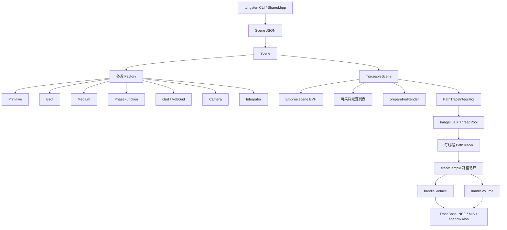

# Tungsten 架构、体积路径追踪与 VDB 异质介质采样

> 本文档以当前仓库源码为准，目标是说明 Tungsten 从场景加载到路径追踪的整体架构、普通参与介质的渲染流程、VDB 异质介质的距离采样，以及本仓库 GPIS 扩展与普通体渲染的本质区别。  
> PBRT 对比同时区分 PBRT-v3 与 PBRT-v4；两代 PBRT 的体积接口并不相同。

## 1. 先给结论

Tungsten 与 PBRT 使用相同的核心蒙特卡洛框架：每一段光线先找到最近的几何表面，再在到达表面之前采样介质；二者竞争成为路径的下一个顶点。

```text
当前光线
  ├─ 先求最近表面距离 t_surface
  └─ 若当前位于介质中，在 [0, t_surface] 采样介质距离 t_medium
       ├─ t_medium < t_surface：处理介质散射顶点
       └─ 没有介质事件：处理表面顶点
```

Tungsten 的 `Medium::sampleDistance()`、`Medium::transmittance()`、`MediumSample` 和 `PhaseFunction`，在接口形态上非常接近 PBRT-v3 的 `Medium::Sample()`、`Medium::Tr()`、`MediumInteraction` 和 `PhaseFunction`。

但本仓库的 `sparse_conv_noise` GPIS 只是复用了这套介质事件管线：它采样的不是指数自由程，而是随机隐式函数的零交叉；它使用的也不是普通体相函数，而是把 GP 梯度当法线的 `BRDFPhaseFunction`。因此 Coffee Mug 的 volume-like 外观不能简单理解成 VDB 密度场的 Beer–Lambert 体渲染。

## 2. 总体架构



Tungsten 没有把所有工作塞进一个巨大的 `Renderer` 类，而是把职责拆成三个层次：

1. `Scene`：描述层，保存 JSON 创建出来的共享对象。
2. `TraceableScene`：运行时层，准备资源、光源和加速结构。
3. `Integrator`/`PathTracer`：执行层，分派像素任务并估计光照积分。

## 3. 场景描述层：`Scene`

[`Scene.hpp`](../src/core/io/Scene.hpp) 中的 `Scene` 保存：

- `Primitive`
- `Medium`
- `Grid`
- `Bsdf`
- `Camera`
- `Integrator`
- `RendererSettings`
- 纹理和外部资源缓存

JSON 解析入口是 [`Scene::fromJson()`](../src/core/io/Scene.cpp)，它按以下顺序构造命名对象：

```cpp
bsdfs
grids
media
primitives
camera
integrator
renderer settings
```

对象既可以直接内嵌在 JSON 中，也可以用名字引用。`instantiate<T>()` 读取对象的 `"type"`，通过 `StringableEnum` 工厂创建具体子类，然后调用 `fromJson()`。

相关工厂包括：

| 工厂 | 典型类型 |
| --- | --- |
| [`PrimitiveFactory`](../src/core/primitives/PrimitiveFactory.cpp) | mesh、cube、sphere、quad、infinite sphere |
| [`BsdfFactory`](../src/core/bsdfs/BsdfFactory.cpp) | lambert、mirror、conductor、dielectric |
| [`MediumFactory`](../src/core/media/MediumFactory.cpp) | homogeneous、voxel、atmosphere、GPIS |
| [`PhaseFunctionFactory`](../src/core/phasefunctions/PhaseFunctionFactory.cpp) | isotropic、HG、Rayleigh、BRDF wrapper |
| [`IntegratorFactory`](../src/core/integrators/IntegratorFactory.cpp) | PT、BDPT、photon map、MLT |
| [`GridFactory`](../src/core/grids/GridFactory.cpp) | OpenVDB grid |

`Scene::loadResources()` 再统一加载纹理、网格、VDB 等外部数据。JSON 的相对文件路径以场景文件所在目录解析。

## 4. 可追踪场景层：`TraceableScene`

CLI 在 [`Shared.hpp`](../src/tungsten/Shared.hpp) 中完成：

```text
Scene::load
  → Scene::loadResources
  → Scene::makeTraceable
  → integrator.startRender
  → integrator.waitForCompletion
  → 保存图像/检查点
```

`Scene::makeTraceable()` 构造 [`TraceableScene`](../src/core/renderer/TraceableScene.hpp)。构造过程中会：

1. 调用 Camera、Medium、BSDF、Primitive 的 `prepareForRender()`。
2. 从 emissive primitives 中收集有限光源和无限环境光。
3. 计算场景包围盒。
4. 把有限 Primitive 注册进 Embree 2 场景。
5. 为每个 primitive 提供 bounds、intersection 和 occlusion 回调。
6. 调用 Integrator 的 `prepareForRender()`。

`TraceableScene::intersect()` 返回最近表面交点，并把 `ray.farT()` 截断为交点距离。这个截断非常重要：随后 Medium 只允许在光线起点到最近表面之间采样事件。

## 5. 执行层：`PathTraceIntegrator` 与 `PathTracer`

这两个相似的名字承担不同职责：

### 5.1 `PathTraceIntegrator`：整张图的任务调度器

[`PathTraceIntegrator.cpp`](../src/core/integrators/path_tracer/PathTraceIntegrator.cpp) 负责：

- 按 tile 切分图像；
- 为 tile 创建 Uniform 或 Sobol path sampler；
- 为每个工作线程创建一个 `PathTracer`；
- 把 tiles 提交给线程池；
- 累积相机 color buffer；
- 自适应采样、检查点和恢复。

核心调用是：

```cpp
tile.sampler->startPath(pixelIndex, sampleIndex);
Vec3f c = tracer->traceSample(pixel, *tile.sampler, spp);
camera.colorBuffer()->addSample(pixel, c);
```

### 5.2 `PathTracer`：追踪一个像素样本

[`PathTracer::traceSample()`](../src/core/integrators/path_tracer/PathTracer.cpp) 才是真正的路径循环。它维护：

- 当前 `Ray`
- `throughput`，即路径吞吐量 $\boldsymbol\beta$
- 累积 `emission`，即样本辐亮度估计 $L$
- 当前 `Medium*`
- `Medium::MediumState`
- 最近表面交点信息
- bounce 数和俄罗斯轮盘状态

其主循环可简化为：

```cpp
ray = sampleCameraRay();
didHit = scene.intersect(ray);  // ray.farT = 最近表面距离

while ((didHit || medium) && bounce < maxBounces) {
    if (medium) {
        medium->sampleDistance(ray, mediumSample);
        L    += beta * mediumSample.emission;
        beta *= mediumSample.weight;
    }

    if (mediumSample.exited) {
        handleSurface(...);
    } else {
        handleVolume(...);
    }

    russianRoulette();
    didHit = scene.intersect(nextRay);
}
```

`MediumSample::exited` 是表面/介质分支的关键：

- `true`：该段未产生介质散射，光线到达 `ray.farT()` 的表面；
- `false`：在表面之前产生了介质事件。

## 6. Primitive、BSDF 与介质边界

[`Primitive`](../src/core/primitives/Primitive.hpp) 同时承担几种角色：

- 几何求交对象；
- BSDF 的宿主；
- 可选发光体；
- 可选的内外介质边界。

每个 primitive 可以有：

```cpp
std::shared_ptr<Medium> _intMedium;
std::shared_ptr<Medium> _extMedium;
```

JSON 写法为：

```json
{
    "type": "cube",
    "bsdf": "forward",
    "int_medium": "smoke"
}
```

`forward` BSDF 表示一个光学上透明、但可以改变当前介质的边界。`TraceBase::handleSurface()` 根据出射方向相对几何法线的侧别调用 `primitive->selectMedium()`，在 `_intMedium` 与 `_extMedium` 之间切换。

这与 PBRT 的 `GeometricPrimitive + MediumInterface{inside, outside}` 是同一种设计思想。

## 7. 体积路径追踪的数学对象

参与介质定义：

$$
\sigma_t(\mathbf x)=\sigma_a(\mathbf x)+\sigma_s(\mathbf x),
$$

其中 $\sigma_a$ 是吸收系数，$\sigma_s$ 是散射系数，$\sigma_t$ 是消光系数。

沿光线 $\mathbf r(t)=\mathbf o+t\mathbf d$ 的光学厚度为：

$$
\boldsymbol\tau(t)
=\int_0^t\boldsymbol\sigma_t(\mathbf r(s))\,\mathrm ds,
$$

标准 Beer–Lambert 透射率为：

$$
\mathbf T(0,t)=\exp[-\boldsymbol\tau(t)].
$$

体积路径追踪不直接对整段入散射积分做确定性数值积分，而是采样一个介质顶点。如果采到距离 $t$，该顶点的 throughput 权重一般具有：

$$
\frac{\mathbf T(0,t)\,\boldsymbol\sigma_s(\mathbf r(t))}{p_t(t)}.
$$

如果该段没有介质事件而到达表面，则权重一般为：

$$
\frac{\mathbf T(0,t_s)}{p_{\mathrm{exit}}(t_s)}.
$$

这些因子都由具体 Medium 打包进 `MediumSample::weight`，所以路径积分器只需执行：

```cpp
throughput *= mediumSample.weight;
```

## 8. Tungsten 的 Medium 抽象

[`Medium.hpp`](../src/core/media/Medium.hpp) 的核心接口是：

```cpp
sigmaA(p)
sigmaS(p)
sigmaT(p)
sampleDistance(sampler, ray, state, sample)
transmittance(sampler, ray, ...)
pdf(sampler, ray, ...)
phaseFunction(p)
```

`MediumSample` 保存：

| 字段 | 含义 |
| --- | --- |
| `t` | 当前段的事件距离 |
| `p` | world-space 事件位置 |
| `weight` | 到该事件的无偏 throughput 权重 |
| `emission` | 体积自发光贡献 |
| `pdf` | 距离事件或退出事件的混合 PDF |
| `exited` | 是否无散射地到达段末表面 |
| `phase` | 事件处相函数 |
| `continuedT/continuedWeight` | 某些双向/相关采样路径所需的继续量 |

仓库包含四类传统介质：

| Medium | 空间分布 | 距离采样 |
| --- | --- | --- |
| `HomogeneousMedium` | 常数密度 | 直接反演自由程 |
| `ExponentialMedium` | 单方向指数衰减 | 解析积分和反演 |
| `AtmosphericMedium` | 球形大气密度 | 误差函数解析积分和反演 |
| `VoxelMedium` | VDB 标量密度 | 数值累计/反演光学厚度 |

GPIS 的 function-space、weight-space 和 sparse convolution medium 是后来接入相同接口的特殊介质。

## 9. 可替换的 Transmittance 是 Tungsten 的特色

Tungsten 将“空间密度分布”和“透射率规律”进一步分开。默认 [`ExponentialTransmittance`](../src/core/transmittances/ExponentialTransmittance.cpp) 返回 $e^{-\tau}$，但 [`Transmittance`](../src/core/transmittances/Transmittance.hpp) 还区分：

- surface → surface
- surface → medium
- medium → surface
- medium → medium

并分别提供概率、PDF 和采样函数。

仓库还包含 Davis、Davis–Weinstein、Erlang、double-exponential、linear、quadratic、tabulated 等非指数透射率模型。这是为了表示具有相关自由程的广义介质；标准 PBRT 体积模型通常以 Beer–Lambert 独立消光为基础。

`MediumState::firstScatter` 让这些模型知道当前段是从表面开始，还是从上一个介质散射点开始。

## 10. 均匀介质的距离采样

以默认指数透射为例，均匀介质满足：

$$
\boldsymbol\tau(t)=\boldsymbol\sigma_t t.
$$

代码从 RGB 三个通道中均匀选择通道 $c$，采样单位光学厚度：

$$
\tau^\star=-\ln(1-\xi),
$$

再变成距离：

$$
t=\frac{\tau^\star}{\sigma_{t,c}}.
$$

若 $t<t_s$，生成介质事件；否则返回表面退出事件。实现位于 [`HomogeneousMedium::sampleDistance()`](../src/core/media/HomogeneousMedium.cpp)。

对 RGB 通道不同的介质，代码使用三通道密度的平均值构造标量 PDF，然后以向量透射率除以该 PDF。这是一种 spectral-channel mixture estimator，只不过这里的“光谱”是固定 RGB，而非 PBRT-v4 的采样波长。

## 11. VDB 异质介质：数据模型

传统 VDB 介质使用：

```json
{
    "name": "explosion",
    "type": "voxel",
    "sigma_a": 4.4,
    "sigma_s": 4.6,
    "phase_function": {
        "type": "henyey_greenstein",
        "g": 0.4
    },
    "transmittance": {
        "type": "exponential"
    },
    "grid": {
        "type": "vdb",
        "file": "fire.vdb",
        "density_name": "density",
        "density_scale": 0.4,
        "emission_name": "Cd",
        "emission_scale": 18.0,
        "normalize_size": false,
        "integration_method": "exact_linear",
        "sampling_method": "exact_linear"
    }
}
```

完整示例见 [`data/example-scenes/voxel-medium/scene.json`](../data/example-scenes/voxel-medium/scene.json)。

密度网格给出标量 $\rho(\mathbf x)$：

$$
\boldsymbol\sigma_a(\mathbf x)=\rho(\mathbf x)\boldsymbol\sigma_a,
$$

$$
\boldsymbol\sigma_s(\mathbf x)=\rho(\mathbf x)\boldsymbol\sigma_s,
$$

$$
\boldsymbol\sigma_t(\mathbf x)=\rho(\mathbf x)(\boldsymbol\sigma_a+\boldsymbol\sigma_s).
$$

`density_scale` 在资源加载时直接乘进所有 active density values。

## 12. VDB 异质介质采样：完整步骤

入口为 [`VoxelMedium::sampleDistance()`](../src/core/media/VoxelMedium.cpp)。下面逐步对应真实代码。

### 12.1 最近表面先限定介质区间

PathTracer 已经执行过表面求交，因此：

```cpp
float maxT = ray.farT();
```

是当前光线起点到最近表面的 world-space 距离。介质不能在该距离之后生成事件。

### 12.2 把光线变到 VDB index space

渲染前 `VoxelMedium::prepareForRender()` 保存：

```cpp
_worldToGrid = _grid->invNaturalTransform();
_gridBounds  = _grid->bounds();
```

采样时：

```cpp
Vec3f p = _worldToGrid * ray.pos();
Vec3f w = _worldToGrid.transformVector(ray.dir());
float wPrime = w.length();
w /= wPrime;
```

令 $M$ 为 world-to-grid 线性变换，则：

$$
\mathbf p_g=M\mathbf o,
\qquad
s=\lVert M\mathbf d\rVert,
\qquad
\mathbf d_g=\frac{M\mathbf d}{s}.
$$

world-space 和 grid-space 距离关系为：

$$
t_g=s\,t_w,
\qquad
t_w=\frac{t_g}{s}.
$$

代码中的 `wPrime` 就是 $s$。所以后续所有网格积分都在 index space 中进行，返回前再除以 `wPrime`。

### 12.3 与 active voxel 包围盒求交

```cpp
float t0 = 0;
float t1 = maxT * wPrime;
bboxIntersection(_gridBounds, p, w, t0, t1);
```

若没有进入 VDB active bounds，该段直接返回：

```text
weight = 1
pdf = 1
exited = true
```

这避免在完全空的空间中遍历体素。

### 12.4 采样目标累计密度

对默认指数透射率，先选择一个 RGB 通道 $c$：

```cpp
int component = sampler.nextDiscrete(3);
float sigmaTc = _sigmaT[component];
```

再采样单位光学厚度：

$$
E=-\ln(1-\xi).
$$

我们想求 world-space 距离 $t_w$，使：

$$
\sigma_{t,c}\int_0^{t_w}\rho(\mathbf r(s))\,\mathrm ds=E.
$$

因为 $\mathrm dt_w=\mathrm dt_g/s$，代码传给 VDB 反演器的目标累计密度是：

$$
A^\star
=\int\rho\,\mathrm dt_g
=\frac{E}{\sigma_{t,c}/s}.
$$

对应代码：

```cpp
float target = transmittance.sample(sampler, firstScatter)
             / (sigmaTc / wPrime);
```

对于非指数 Transmittance，`sample()` 返回该透射率模型下的目标 optical-depth variable，但后续空间反演步骤相同。

### 12.5 反演累计密度积分

随后调用：

```cpp
Vec2f tAndDensity = _grid->inverseOpticalDepth(
    sampler, p, w, t0, t1, target);
```

它求解：

$$
\int_{t_0}^{t_g}\rho(\mathbf p_g+u\mathbf d_g)\,\mathrm du=A^\star.
$$

返回值有两个不同语义：

- 找到事件时：`(t_grid, rho_at_event)`；
- 没找到、离开网格时：`(t1, accumulated_density)`。

调用者通过 `sample.exited` 区分第二个分量究竟是局部密度还是累计积分。

### 12.6 构造 RGB 光学厚度

若光线离开网格，代码用实际累计积分替换原来的目标值。随后计算：

$$
\boldsymbol\tau
=A\frac{\boldsymbol\sigma_t}{s}.
$$

这里除以 $s$ 正是把 grid-space 积分换回 world-space 光学厚度。

### 12.7 计算退出事件的 PDF 和权重

若没有介质事件，默认指数透射下：

$$
\mathbf T=e^{-\boldsymbol\tau},
$$

$$
p_{\mathrm{exit}}
=\frac{1}{3}\sum_{c\in\{R,G,B\}}T_c,
$$

$$
\mathbf w_{\mathrm{exit}}
=\frac{\mathbf T}{p_{\mathrm{exit}}}.
$$

这让三通道混合采样保持无偏。

### 12.8 计算介质事件的 PDF 和权重

若采到事件，令事件处密度为 $\rho_t$。默认指数透射下：

$$
p_t(t)
=\frac{1}{3}\sum_c
\rho_t\sigma_{t,c}T_c,
$$

$$
\mathbf w_t
=\frac{
\mathbf T\,\rho_t\boldsymbol\sigma_s
}{p_t(t)}.
$$

若 VDB 中还存在 emission grid，事件处还计算：

$$
\mathbf L_e(\mathbf x_t)
\frac{\mathbf T}{p_t(t)}.
$$

最后将 grid-space 距离变回 world-space：

```cpp
sample.t /= wPrime;
sample.p = ray.pos() + sample.t * ray.dir();
sample.phase = _phaseFunction.get();
```

## 13. `integration_method` 与 `sampling_method` 的区别

这两个设置解决不同问题：

| 参数 | 调用函数 | 用途 |
| --- | --- | --- |
| `integration_method` | `VdbGrid::opticalDepth()` | 已知光线区间，计算 $\int\rho\,dt$，用于阴影透射和纯吸收 |
| `sampling_method` | `VdbGrid::inverseOpticalDepth()` | 已知目标累计密度，寻找事件距离 |

它们可以不同，但通常应选用相近精度的组合，避免 camera path 与 shadow ray 使用差异过大的密度积分近似。

### 13.1 `exact_nearest`

使用 VDB DDA 穿过体素，将每个体素视为分段常数：

$$
A\mathrel{+}=\rho_i(t_{i+1}-t_i).
$$

距离反演时，在累计积分首次超过目标的体素内做一次线性求解。优点是稳定、结果与 nearest voxel 表示一致；缺点是容易显示体素块状结构。

### 13.2 `exact_linear`

按 DDA 分段，在区间端点采密度，并使用梯形积分：

$$
A\mathrel{+}=\frac{\rho_a+\rho_b}{2}(t_b-t_a).
$$

反演时在命中段内解线性密度对应的二次累计积分。

需要注意：当前 fork 的 [`VdbGrid.cpp`](../src/core/grids/VdbGrid.cpp) 中，供此路径使用的 `gridAt()` 实际硬编码为 `QuadraticSampler`。因此这里的名称保留为 `exact_linear`，但从严格数值意义上说，它不是“对当前 quadratic 插值场的全段解析精确积分”。

### 13.3 `raymarching`

第一个步长随机抖动：

$$
\Delta t_0=\xi\,\Delta t,
$$

之后用固定 `step_size`，每段做梯形累计。反演时在首次跨过目标的步长内插值事件位置。

VDB grid 内部的 `step_size` 处于 **grid index space**。若 world-to-grid 方向缩放为 `wPrime`，其有效 world-space 步长为：

$$
\Delta t_{world}
=\frac{\Delta t_{grid}}{\texttt{wPrime}}.
$$

对均匀体素，可近似理解为：

```text
world step ≈ JSON grid step_size × world voxel size
```

### 13.4 `residual_ratio`

只用于 `integration_method`。加载时先构造低分辨率 super-grid，每格保存 control density 和 residual majorant；查询时解析积分 control 部分，并通过 residual ratio tracking 随机估计剩余透射率。

`sampling_method` 没有 residual-ratio 选项，因此它不能直接用来反演生成介质事件位置。

## 14. 三种容易混淆的“步长”

| 位置 | 单位 | 作用 |
| --- | --- | --- |
| `VoxelMedium.grid.step_size` | VDB index space | 普通 VDB 密度积分/反演 |
| `SparseConvolutionNoiseMedium.step_size` | world space | 对 $f=\mu+\psi$ 做零交叉 marching |
| covariance `lengthScale` | world/isotropic space | 控制 GP 随机场相关尺度 |

Coffee Mug JSON 中 VDB grid 内写的：

```json
"integration_method": "raymarching",
"step_size": 5.0
```

不会控制 GPIS 的零交叉步长。GPIS 使用 medium 顶层的：

```json
"step_size": 0.01
```

## 15. 介质顶点的直接光照与 MIS

采到体积事件后，PathTracer 调用 [`TraceBase::handleVolume()`](../src/core/integrators/TraceBase.cpp)。它执行：

1. 可选的 `volumeEstimateDirect()`；
2. 从 PhaseFunction 采样续接方向；
3. 更新 throughput 和下一条 ray。

直接光照同时支持两种 proposal：

### 15.1 Light sampling

```text
chooseLight
  → light.sampleDirect
  → phase.eval(wi, lightDirection)
  → shadow-ray transmittance
  → 除以 light PDF
```

### 15.2 Phase sampling

```text
phase.sample
  → 沿 phase direction 寻找指定光源
  → shadow-ray transmittance
  → 乘 phase sample weight
```

非 delta 光源下，两种策略用 power heuristic 合并。路径继续方向仍由 PhaseFunction 再采一次；direct-light phase sample 是当前顶点的 NEE/MIS 估计器组成部分，不等于续接主路径。

## 16. 阴影光线如何穿过多个介质

[`TraceBase::generalizedShadowRay()`](../src/core/integrators/TraceBase.cpp) 不只是测试布尔遮挡。它会循环：

1. 找到阴影 ray 上的下一个几何表面；
2. 累乘当前 medium 的 `transmittance()`；
3. 若表面不是 forward/null，立即返回 0；
4. 若是透明介质边界，乘其 transparency；
5. 用 `selectMedium()` 更新当前介质；
6. 从边界后继续，直到到达光源。

所以阴影贡献为：

$$
\mathbf T_{total}
=\prod_i\mathbf T_i\prod_j\mathbf f_{forward,j}.
$$

这对应 PBRT-v3 的 `VisibilityTester::Tr()` / `Scene::IntersectTr()` 思路。

## 17. Coffee Mug 的 VDB 为什么不是上述传统体积采样

Coffee Mug 使用的是：

```json
"type": "sparse_conv_noise"
```

而不是：

```json
"type": "voxel"
```

因此 `cup-3.vdb` 中的 `mean` 和 `variance` 只作为 GP 参数场查询：

$$
f(\mathbf x)=\mu(\mathbf x)+\psi(\mathbf x).
$$

- `mean` 决定宏观隐式函数；
- `variance` 实际作为局部随机振幅乘数；
- sparse convolution 在运行时生成 $\psi$；
- `SparseConvolutionNoiseMedium::intersectGP()` 寻找 $f=0$。

它不会计算：

$$
\int\rho(\mathbf r(t))\,dt,
$$

也不会调用 `VoxelMedium::inverseOpticalDepth()`。

命中 $f=0$ 后，[`GaussianProcessMedium::sampleDistance()`](../src/core/media/GaussianProcessMedium.cpp) 把它包装成 `exited=false` 的 MediumSample，使现有 PathTracer 进入 `handleVolume()`。随后 [`BRDFPhaseFunction`](../src/core/phasefunctions/BRDFPhaseFunction.cpp) 将：

$$
\mathbf n=\frac{\nabla f}{\lVert\nabla f\rVert}
$$

设为局部表面法线，再调用 mirror/conductor BSDF。

GPIS shadow transmittance 也是二值的：

$$
T=
\begin{cases}
0,&\text{阴影段上存在零交叉},\\
1,&\text{不存在零交叉}.
\end{cases}
$$

所以它在接口上是 medium，在物理事件上却是随机隐式表面。

## 18. 与 PBRT 的逐项对应

| Tungsten | PBRT-v3 | 含义 |
| --- | --- | --- |
| `Scene` / `TraceableScene` | `Scene` + `Aggregate` | 场景对象与可求交集合 |
| `Primitive` | `GeometricPrimitive` | 几何、材质、介质边界 |
| `IntersectionInfo` | `SurfaceInteraction` | 表面交点信息 |
| `SurfaceScatterEvent` | `BSDF` 采样上下文 | 局部坐标与 BSDF 事件 |
| `Medium::sampleDistance()` | `Medium::Sample()` | 在最近表面之前采介质顶点 |
| `Medium::transmittance()` | `Medium::Tr()` | 计算一段光线透射 |
| `MediumSample` | `MediumInteraction` + 返回权重 | 介质顶点与 throughput 信息 |
| `PhaseFunction` | `PhaseFunction` | 介质方向散射 |
| `int_medium/ext_medium` | `MediumInterface` | 表面两侧介质 |
| `generalizedShadowRay()` | `IntersectTr()` | 穿透明边界并累积透射 |
| `PathTracer::traceSample()` | `VolPathIntegrator::Li()` | 表面/介质交替路径循环 |

PBRT-v3 的官方 Media 章节：<https://www.pbr-book.org/3ed-2018/Volume_Scattering/Media>  
PBRT-v3 的体积路径追踪章节：<https://www.pbr-book.org/3ed-2018/Light_Transport_II_Volume_Rendering/Volumetric_Light_Transport>

### 18.1 与 PBRT-v4 的差别

PBRT-v4 对异质介质采用 `RayMajorantIterator` 和 `SampleT_maj()`。Medium 提供沿 ray 的 majorant segments，积分器通过回调处理可能连续出现的 null-scattering candidates。这比 PBRT-v3/Tungsten 的“调用一次 Medium 方法并返回一次事件或退出”接口更适合现代 spectral tracking 和 GPU wavefront 执行。

PBRT-v4 官方章节：<https://www.pbr-book.org/4ed/Light_Transport_II_Volume_Rendering/Volume_Scattering_Integrators>

### 18.2 其他工程差异

| 方面 | Tungsten | PBRT-v4 |
| --- | --- | --- |
| 颜色 | `Vec3f` RGB | sampled wavelengths / spectrum |
| 多态 | 经典虚函数、继承、`shared_ptr` | tagged pointer/type dispatch 较多 |
| 场景格式 | JSON，字符串工厂 | PBRT scene description/parser |
| 光源 | emissive Primitive 同时充当 light | Light 抽象更独立 |
| 加速结构 | 当前仓库使用 Embree 2 | Aggregate/BVH 架构 |
| 异质介质 | Medium 内部积分并反演累计密度 | majorant + null scattering |
| 特殊能力 | 可替换的非指数 Transmittance、GPIS | spectral rendering、wavefront/GPU |

## 19. VDB 介质参数的实际调节建议

### `density_scale`

等价于同时放大局部 $\sigma_a$ 和 $\sigma_s$。值越大，平均自由程越短，介质越浓。

### `sigma_a` 与 `sigma_s`

总密度由 $\sigma_t=\sigma_a+\sigma_s$ 控制；单次散射反照率为：

$$
\boldsymbol\alpha
=\frac{\boldsymbol\sigma_s}{\boldsymbol\sigma_t}.
$$

- 增大 `sigma_a`：更暗、吸收更强；
- 增大 `sigma_s`：散射更多；
- 同比例放大二者：反照率近似不变，但自由程缩短。

### `sampling_method`

- 验证正确性：优先 `exact_linear`；
- 密度明确是 nearest voxel：用 `exact_nearest`；
- 快速实验：可用 `raymarching`，但要做步长收敛测试。

### `integration_method`

建议先与 `sampling_method` 一致。密集大体积的阴影透射非常昂贵时，再比较 `residual_ratio`。

### VDB `step_size`

它以体素/index-space 为单位。比如体素 world size 为 0.01，`step_size=5` 的有效 world 步长约为 0.05。必须同时检查缩放后的实际体素尺寸。

### `phase_function`

Henyey–Greenstein 的 `g` 控制方向性：

- $g=0$：各向同性；
- $g>0$：前向散射；
- $g<0$：后向散射。

## 20. 推荐源码阅读顺序

1. [`Scene.cpp`](../src/core/io/Scene.cpp)：JSON 对象系统。
2. [`TraceableScene.hpp`](../src/core/renderer/TraceableScene.hpp)：资源准备、光源和 Embree。
3. [`PathTraceIntegrator.cpp`](../src/core/integrators/path_tracer/PathTraceIntegrator.cpp)：tile/SPP/线程调度。
4. [`PathTracer.cpp`](../src/core/integrators/path_tracer/PathTracer.cpp)：一条完整路径。
5. [`Medium.hpp`](../src/core/media/Medium.hpp) 与 [`MediumSample.hpp`](../src/core/samplerecords/MediumSample.hpp)：介质接口契约。
6. [`HomogeneousMedium.cpp`](../src/core/media/HomogeneousMedium.cpp)：最简单的距离采样和权重。
7. [`VoxelMedium.cpp`](../src/core/media/VoxelMedium.cpp)：VDB 空间变换、目标光学厚度和事件 PDF。
8. [`VdbGrid.cpp`](../src/core/grids/VdbGrid.cpp)：密度积分和反演。
9. [`TraceBase.cpp`](../src/core/integrators/TraceBase.cpp)：直接光照、phase sampling、MIS 和 shadow transmittance。
10. [`GaussianProcessMedium.cpp`](../src/core/media/GaussianProcessMedium.cpp)：GPIS 对 Medium 接口的复用。
11. [`BRDFPhaseFunction.cpp`](../src/core/phasefunctions/BRDFPhaseFunction.cpp)：GPIS 事件到 BSDF 事件的适配。

按这个顺序，先能理解标准体积路径追踪，再看 GPIS 时就会清楚哪些部分是通用框架，哪些部分是论文为随机隐式表面新增的逻辑。
