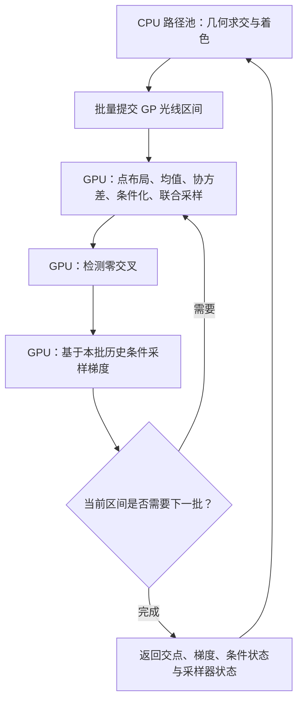

# Shaderball 函数空间 GP：CPU 瓶颈实测与 GPU 方案

测试日期：2026-10-05。输入为 `gpis-scenes/shaderball_ply/scene-function-space.json`。

## 1. 结论

当前 32 点函数空间实现的主要开销是：

1. 对联合高斯采样协方差做特征值分解，约占 GP 工作时间的 **31.61%**。
2. 梯度条件化的矩阵伪逆，约占 **27.73%**。
3. 单独计时的协方差构建，约占 **24.60%**。

三项合计 **83.94%**。梯度采样整体占 **49.67%**，阴影查询整体占
**25.85%**；它们是两个不同维度的分类，不能相加。

这次测量支持优先迁移批量谱分解、条件化和协方差构建。只迁移光线上的
函数值采样，或者只提供 Cholesky 分解，都会留下很大的 CPU 开销。

本次增加了可关闭的计时和复现工具，没有实现函数空间 CUDA 后端，也没有修改场景配置。

## 2. 测试条件与耗时

- Windows，MSVC Release（`/O2 /Ob2 /DNDEBUG`）。
- 通常使用 8 个渲染 worker，另有 1 worker 对照。
- 固定 scene seed 为 12345，启用独立路径采样。
- 相机、VDB 均值、SE 协方差、导体材质、直接光照、20 次反弹上限保持一致。
- `correlation_context=renewal+`，`normal_method=conditioned_gaussian`。
- 步长保持为 `0.0004402317121121213`，长度尺度约 `0.0028284273`。
- 只在生成的测试副本中改变分辨率、spp、采样点数和线程数。
- CPU 测试期间不并行运行其他本任务的构建或渲染。
- GPU 方案针对本机 RTX 4060 Laptop GPU；CMake 使用 CUDA 13.1.80。

| 分辨率 / spp | 采样点数 | workers | 关闭计时：渲染秒数 | 开启计时：渲染秒数 |
| --- | ---: | ---: | ---: | ---: |
| 128×128 / 4，第一轮 | 32 | 8 | 14.64 | 13.86 |
| 128×128 / 4，第二轮 | 32 | 8 | 10.57 | 10.86 |
| 512×512 / 2 | 32 | 8 | **112.77** | 119.41 |
| 128×128 / 2 | 8 | 8 | 3.80 | 4.19 |
| 128×128 / 2 | 16 | 8 | 4.08 | 4.24 |
| 128×128 / 2 | 32 | 8 | 5.21 | 5.33 |
| 128×128 / 2 | 32 | 1 | 64.08 | 66.07 |

关闭计时的值用于描述实际渲染耗时，开启计时的值用于分析开销分布。
512×512 配对中计时增加约 5.89% 的渲染耗时。128×128 的重复运行显示
明显的运行环境/频率波动，不能把某次开启计时更快解读为计时具有加速效果，
也不应据此认定固定的线程扩展比。主要阶段的占比在重复运行和单线程测试中稳定。

`sample_points` 改变每批覆盖区间、条件化频率和数值离散化；上述 8/16/32 点
结果用于诊断矩阵规模的影响，不证明它们具有相同图像精度或收敛结果。
本次未运行完整 512×512 / 256 spp。

原始数据：

- `build/function_space_profile_shaderball/report.json`：场景快照、逐次耗时、计时、矩阵维数与图像对照。
- `build/function_space_profile_shaderball/analysis.json`：512×512 参考运行的汇总。
- 同目录下各次 `.json`、`.log` 和输出目录中的 `scene.pfm`。

512×512 关闭计时的渲染已完成，但最初的日志解析未处理 `1m 52s 768ms`
这种时长格式，工具中断后从完整日志和图像恢复了这次结果。因此该运行的
进程 wall time 和 CPU time 记为 `null`，112.77 秒来自完整渲染进度日志。
工具现在从进度日志读取秒数，支持 `--resume` 恢复已完成的运行。

## 3. 512×512 / 2 spp 的详细结果

### 3.1 按计算阶段分类

以下为计时覆盖的函数空间求交和梯度采样的 **worker 时间总和**，不是整帧 wall time。
父计时扣除了子计时；表中排他的阶段可以相加，避免条件化与内部求解重复计数。

| 阶段 | GP 时间占比 |
| --- | ---: |
| 高斯采样的特征值分解及平方根变换 | 31.61% |
| 条件化伪逆 | 27.73% |
| 单独计时的协方差构建 | 24.60% |
| 单独计时的均值查询 | 7.71% |
| 条件分布组装等剩余工作 | 2.90% |
| Cholesky 尝试 | 1.74% |
| 初始联合均值/协方差构建（同一循环，合并计时） | 1.48% |
| 求交剩余工作：点布局、符号检测、上下文等 | 0.98% |
| 高斯随机数、变换与约束检查 | 0.83% |
| 梯度剩余工作 | 0.42% |
| PSD projection | 0.00% |

累计覆盖约 949.44 worker 秒。128×128 的两次测量中，特征值分解占
30.65–31.44%，伪逆占 26.42–27.31%，协方差构建占 24.74–25.29%。
单线程结果分别为 31.97%、28.11%、24.71%。瓶颈排序一致。

### 3.2 按查询用途和采样类型分类

这张表使用各自根计时的包含时间，四行互不重叠：

| 查询 | 函数调用次数 | GP 时间占比 |
| --- | ---: | ---: |
| 主路径函数值批次求交 | 1,992,933 | 35.21% |
| 主路径梯度采样 | 1,992,933 | 38.93% |
| 阴影函数值批次求交 | 810,544 | 15.12% |
| 阴影梯度采样 | 609,284 | 10.73% |

这些求交调用是一段 GP 光线内部的采样批次，不是 GPU 提交次数，也不是独立路径数。
函数空间代码会在未命中、需要继续下一批时采样梯度，再更新 Renewal+ 的条件信息。
不能把梯度全部理解为最终交点的着色法线。

### 3.3 最关键的矩阵统计

- 32 点函数值采样共 **2,803,477** 次 Cholesky 尝试，成功 **0** 次；
  全部改用 `SelfAdjointEigenSolver`。特征值分解失败计数为 0。
- Renewal+ 的后续函数值采样通常只有 2 个条件，相关伪逆是 2×2。
- 梯度的输出维数为 2（命中）或 3（未命中），但条件矩阵维数为 **3–33**。
- 梯度条件矩阵中，32 维共 **1,910,511** 次，占梯度查询约 **73.42%**；
  33 维共 **21,723** 次。

`32×32` Cholesky 失败并不意味着求交报错。数学上的 SE Gram 矩阵在
密集且强相关的点布局下可能在浮点计算中接近奇异，现有实现对此提供了
特征值分解回退。这次没有另外测量条件数，因此这里只确认失败频率，
没有把所有失败归因于某一个数值原因。

梯度的 2/3 维输出不能消除计算条件矩阵伪逆的成本。源码调用链是：

```text
FunctionSpaceGaussianProcessMedium::sampleGradient
  → GPRealNodeValues::sampleGrad
  → GaussianProcess::sample_cond
  → create_mvn_cond
      → 构建历史样本的 Kcc
      → pseudo_inverse(Kcc)
      → 条件均值与条件协方差
      → 2/3 维高斯采样
```

## 4. 根据实测提出的 GPU 方案

### 阶段 A：验证批量谱分解的收益

先用真实场景捕获的矩阵做独立微基准，比较 GPU 与 8-worker CPU，纳入传输与提交成本。
测试 batch=64/256/1024/4096，覆盖：

1. 函数值采样的 32×32 条件协方差及其特征值/特征向量。
2. 梯度条件化的 3–33 维 Kcc，重点测试 32 维，保留 33 维覆盖。
3. CPU 使用的谱截断阈值、伪逆作用于 2/3 个 RHS，以及高斯样本生成。

优先试用 CUDA 13.1 的 `cusolverDnDsyevjBatched`；它提供双精度批量对称
矩阵特征值分解，要求同一批次的矩阵尺寸一致并连续存储。
因此需要按维数分组，或使用经验证的填充方案。
检查每个矩阵的 `info`，自行测量残差；非收敛必须有正确回退。
[官方文档](https://docs.nvidia.com/cuda/archive/13.1.0/cusolver/index.html#cusolverdn-t-syevjbatched)

这次场景中 Cholesky 没有成功，不宜把只有 `potrfBatched` 的实现作为第一版性能方案。
后续可加入 Cholesky 快速路径，覆盖其他更适合它的点布局。

伪逆不必先在 GPU 上形成完整的稠密逆矩阵。对 `Kcc = U Λ Uᵀ`，可以直接计算：

```text
Kcc† B = U [Λ† (Uᵀ B)]
```

保持 CPU 的阈值 `1e6 * DBL_EPSILON * max(abs(eigenvalues))`。
高斯采样同样可以直接计算 `μ + U (sqrt(max(λ,0)) * z)`，减少中间矩阵。
这是有限维 GP 的矩阵运算，不引入 RFF 或稀疏卷积表示。

### 阶段 B：接入现有路径池，提交完整 GP 查询

复用现有路径池、异步 `submitBatch()`、多 stream/slot 和不可变 GPU VDB 均值网格。
新增 `FunctionSpaceBatchBackend`，第一版支持：

- 单个 standard GP，平稳各向同性 SE 协方差。
- 当前 shaderball 的线性插值 VDB 均值。
- Renewal+，32 个函数值采样点，条件高斯法线。
- 主路径与阴影查询。
- 双精度协方差、条件化及分解；均值查询遵循当前 VDB 的浮点语义。

需要扩展当前接口。`GpRaySegmentRequest` 绑定的是
`SparseConvolutionNoiseMedium`，`PathTracer` 的可挂起路径也只识别该类型。
应增加查询类型/能力接口与函数空间请求，而不是把它伪装成噪声请求。

请求携带：medium/config ID、光线区间、Purpose、条件状态、采样器状态。
回复携带：hit/t/value、有效梯度、GP ID、更新后的条件上下文与采样器状态。
异步请求还需要明确状态所有权、路径代次和完成/取消后的释放规则。



一段 GP 查询内部的批次可以通过多次 GPU kernel/库调用执行。
保持中间矩阵和采样历史在设备上，避免每 32 个点就回传 CPU；GPU kernel
启动次数与 CPU 提交/等待次数不是同一个指标。

主查询的 2 维 Renewal+ 条件可用小矩阵特化；梯度条件化必须处理实际的
3–33 维历史矩阵。失败后的 CPU 重试需要恢复查询输入和 RNG 状态，不能重新抽取一条射线。

### 阶段 C：SE 特化与完整验证

- 将 SE 的值/导数协方差和小矩阵乘法特化，减少通用函数调用及临时分配。
- 对相同超参数、点布局和条件布局复用计算；当前点布局带随机偏移和尾段，
  不能假设所有射线共享同一个 32×32 分解。
- 同一直线上的函数值与各向同性 SE 的切向梯度具有零协方差，存在进一步
  简化法线条件化的机会。先验证当前条件集、坐标系和记忆模型满足条件，
  再采用解析特化；未命中批次所需的纵向导数仍需条件采样。
- 保持 `TabulatedMean` 的前向差分语义（世界空间 `eps=0.001`），避免换成
  纹理解析梯度而改变参考模型。
- 检查矩阵残差、伪逆阈值、条件均值/协方差和采样统计；然后比较多种 seed
  的渲染统计与收敛，而不是仅凭单张图像判断。
- GPU 谱分解的特征向量符号/基底可能不同，固定 `z` 不保证逐像素一致。
  本次 CPU 计时验证要求逐像素一致；未来 GPU 验证需要区分数值与分布的一致性。
- 先保留双精度语义；单精度、混合精度或额外对角扰动需要单独评估其分布变化。

## 5. 收益范围与实施顺序

如果仅加速特征值平方根和伪逆两项（合计 59.34%），即使它们耗时降到零，
GP 阶段的理论加速上限也只有约 **2.46×**；整帧还要计入其他工作和 GPU 提交开销。
所以完整后端应同时迁移协方差构建、均值查询、函数值和梯度采样。

这只是按 CPU 时间占比推导的上限，不是 GPU 实测加速比。RTX 4060 Laptop
上的双精度小矩阵吞吐量、批次大小和传输成本，需要阶段 A 的微基准确认。

推荐顺序：**真实矩阵的批量谱分解微基准 → SE/Renewal+ 整段查询后端 →
现有路径池的主/阴影接入 → 数值与渲染统计验证 → 性能调优**。
当前不需要重写整个渲染器。

## 6. 计时工具、复现与验证

新增 `src/core/math/FunctionSpaceProfile.hpp`：

- 通过 `TUNGSTEN_GPIS_FS_PROFILE=1` 开启；默认关闭。
- thread-local 累计，线程首次注册时加锁，矩阵内循环没有原子计数。
- 按主/阴影、求交/梯度区分计时，输出包含与排他 worker 时间和矩阵维数直方图。
- 进程退出时输出一行 `GPIS function-space profile: {...}` JSON。
- 不更改矩阵、条件状态、随机数或采样参数。

```powershell
cmake --build build --config Release --target tungsten -j 2
python tools/profile_function_space_gpis.py gpis-scenes/shaderball_ply/scene-function-space.json --output build/function_space_profile_repeat
```

只复现高分辨率或采样点数对照：

```powershell
python tools/profile_function_space_gpis.py gpis-scenes/shaderball_ply/scene-function-space.json --cases 512x2 --output build/function_space_profile_512
python tools/profile_function_space_gpis.py gpis-scenes/shaderball_ply/scene-function-space.json --cases n8,n16,n32 --output build/function_space_profile_points
```

已经完成的检查：

- Release 编译成功。
- 计时加入前的程序与新程序关闭计时的 128×128 / 4 spp 输出逐像素一致。
- 各测试配置开启/关闭计时的 PFM 输出逐像素一致。
- 重复运行输出一致；相同 128×128 / 2 spp / 32 点配置的 1/8 worker 输出一致。
- 所有测试都完成指定 spp，PFM 所有值有限，没有发现矩阵分解错误日志。

上述检查验证计时没有改变 CPU 渲染，不验证 32 点离散化已经收敛到连续 GPIS。
